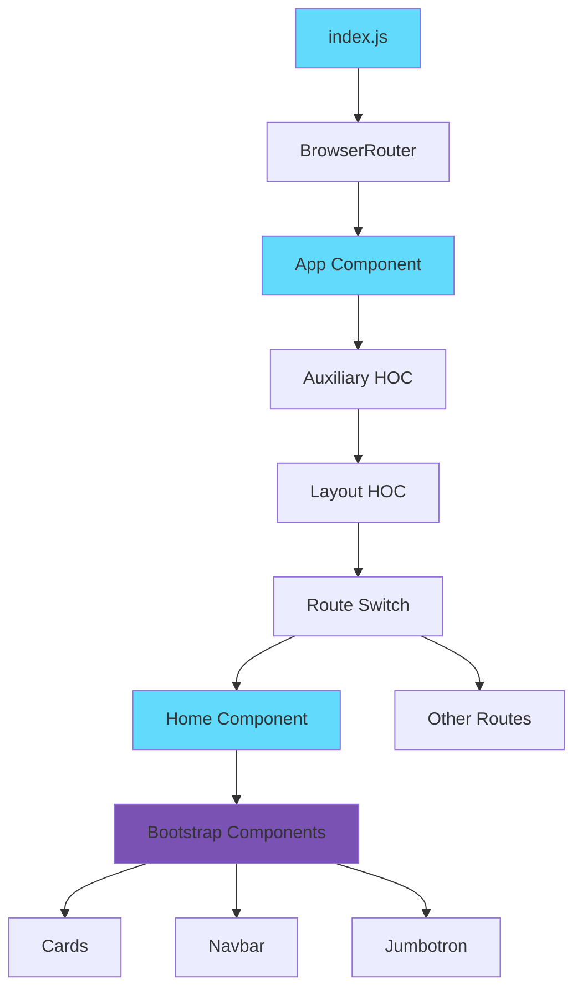
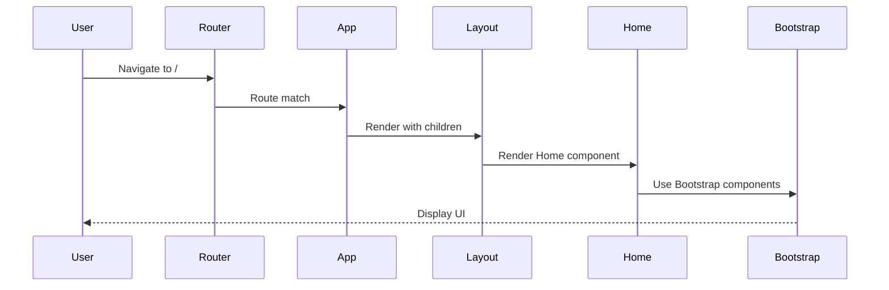

# React Bootstrap 4

A React.js starter kit with Bootstrap 4 integration and SCSS styling, designed to provide a clean and scalable foundation for building modern web applications with responsive layouts and reusable components.

Built in December 2018, this boilerplate streamlines setup by combining React’s component-based architecture with a flexible UI framework for rapid prototyping and polished interfaces. It includes custom SCSS support for easier theme customization, maintainable stylesheets, and organized design assets, making it a strong starting point for efficient front-end development.

## Features

### Core Capabilities

- **Bootstrap 4 Integration**: Full access to Bootstrap's grid system, components, and utilities.
- **Custom SCSS Pipeline**: Advanced styling with variables, mixins, and nested rules.
- **Responsive Layouts**: Mobile-first design principles out of the box.
- **Modern React**: Functional and class-based components with lifecycle management.
- **Hot Module Replacement**: Rapid development with real-time browser updates.

### Technical Excellence

- **Clean Architecture**: Separation of concerns between containers, components, and HOCs.
- **Optimized Bundling**: Webpack configuration for efficient production builds.
- **PWA Support**: Built-in service worker for offline capabilities and app manifest.
- **Standardized Styling**: BEM-inspired naming convention for maintainable SCSS.
- **Strict Linting**: Pre-configured rules for consistent code quality.

### Developer Experience

- **Zero Config Setup**: Quick start with pre-configured development environment.
- **Interactive Testing**: Built-in test runner with watch mode for immediate feedback.
- **Clear Documentation**: Comprehensive guides for setup, usage, and extension.
- **Modular Design**: Easy to add new features without affecting existing functionality.
- **Ready-to-Use Examples**: Includes a complete home page with album layout.

- ⚛️ React.js for component-based UI development
- 🎨 Bootstrap 4 for responsive design and pre-built components
- 💅 SCSS for advanced styling with variables and mixins
- 🛣️ React Router for client-side routing
- 📦 Webpack configuration with hot module replacement
- 🔧 Create React App foundation with customizations
- 🎯 Higher-order components (HOC) pattern
- 📱 Mobile-responsive layout

## Getting Started

### Prerequisites

- Node.js (v8 or higher)
- npm or yarn

### Installation

1. Clone the repository:

```bash
git clone https://github.com/orassayag/react-bootstrap-4.git
cd react-bootstrap-4
```

2. Install dependencies:

```bash
npm install
```

3. Start the development server:

```bash
npm start
```

The application will open at [http://localhost:3000](http://localhost:3000)

## Configuration

The project uses environment variables for configuration. Create a `.env` file in the root directory:

```env
REACT_APP_API_URL=https://api.example.com
REACT_APP_DEBUG=true
```

Access these variables in your code using `process.env.REACT_APP_...`.

## Usage

This starter kit is designed for building responsive web applications. Use the provided containers and components as a baseline:

1. **Containers**: Page-level components that manage state and routing.
2. **Components**: Reusable UI elements (use Bootstrap classes).
3. **HOCs**: Higher-order components for shared logic (Layout, Auxiliary).
4. **Styles**: SCSS files scoped to individual components.

## Development

### Code Quality

- **Formatting**: The project uses Prettier for consistent code formatting.
- **Linting**: ESLint is configured to catch common errors and enforce best practices.

### Local Development

- Run `npm start` for development mode.
- Use `npm test` to run the test suite.
- Changes in `src/` will trigger an automatic reload.

## Available Scripts

### Start

Runs the app in development mode with hot reloading:

```bash
npm start
```

### Build

Creates an optimized production build:

```bash
npm run build
```

### Test

Launches the test runner in interactive watch mode:

```bash
npm test
```

## Project Structure

```
react-bootstrap-4/
├── public/
│   ├── index.html          # HTML template
│   ├── manifest.json       # PWA manifest
│   └── favicon.ico         # App icon
├── src/
│   ├── containers/         # Page-level components
│   │   ├── App/           # Main app container with routing
│   │   └── Home/          # Home page with album example
│   ├── hoc/               # Higher-order components
│   │   ├── Layout/        # Layout wrapper
│   │   └── Auxiliary/     # Auxiliary wrapper
│   ├── index.js           # Application entry point
│   └── serviceWorker.js   # PWA service worker
├── config/                 # Webpack configuration
├── scripts/               # Build scripts
└── package.json
```

### Directory Structure

The project follows a modular structure organized by purpose:

- `src/containers/`: Page-level components and routing logic.
- `src/hoc/`: Higher-order components for shared functionality.
- `src/index.js`: Main entry point for the React application.
- `public/`: Static assets and the main HTML template.
- `config/`: Webpack and build configuration files.

## Architecture



### Architecture Principles

- **Component Isolation**: Each component should be self-contained with its own logic and styles.
- **HOC Pattern**: Use Higher-Order Components for cross-cutting concerns like layout.
- **Container/Presentational Split**: Separate data fetching/state management from UI rendering.
- **Single Source of Truth**: Manage application state predictably within containers.

### Design Patterns

- **Higher-Order Components (HOC)**: Wrapping components to provide shared functionality (e.g., `Layout`).
- **Auxiliary Wrapper**: A pattern for returning multiple elements without a wrapping DOM node.
- **Composition**: Building complex UIs by combining smaller, focused components.
- **CSS-in-JS (SCSS)**: Component-scoped styling using SCSS imports.

## Component Flow



## Using Bootstrap Components

This template includes Bootstrap 4. Use Bootstrap classes directly:

```jsx
<div className='container'>
  <div className='row'>
    <div className='col-md-6'>
      <button className='btn btn-primary'>Click Me</button>
    </div>
  </div>
</div>
```

## Custom Styling with SCSS

Each component can have its own SCSS file:

```scss
.home {
  background-color: #f5f5f5;

  &__header {
    padding: 2rem;
  }

  &__content {
    margin: 1rem 0;
  }
}
```

## Adding New Components

1. Create a new folder in `src/containers/`
2. Add `ComponentName.jsx` and `ComponentName.scss`
3. Export from `src/containers/index.js`
4. Add route in `src/containers/App/App.jsx`

## Best Practices

- **Naming Conventions**: Use PascalCase for components and camelCase for props/functions.
- **Prop Validation**: Always define `propTypes` for components to catch data type issues early.
- **Component Size**: Keep components small and focused on a single responsibility.
- **Styles**: Use the BEM naming convention for SCSS classes to avoid collisions.
- **Performance**: Use `shouldComponentUpdate` or `React.memo` where appropriate.

## Built With

- [React.js](https://reactjs.org) - JavaScript library for building user interfaces
- [Bootstrap 4](https://getbootstrap.com) - CSS framework for responsive design
- [React Router](https://reactrouter.com) - Routing library for React
- [Node-sass](https://github.com/sass/node-sass) - SCSS compiler
- [Webpack](https://webpack.js.org) - Module bundler
- [Git](https://git-scm.com) - Source management

## Contributing

Contributions to this project are [released](https://help.github.com/articles/github-terms-of-service/#6-contributions-under-repository-license) to the public under the [project's open source license](LICENSE).

Everyone is welcome to contribute. Contributing doesn't just mean submitting pull requests—there are many different ways to get involved, including answering questions and reporting issues.

Please feel free to contact me with any question, comment, pull-request, issue, or any other thing you have in mind.

## License

This application has an MIT license - see the [LICENSE](LICENSE) file for details.

## Support

For questions, issues, or contributions:

- **GitHub Issues**: [https://github.com/orassayag/react-bootstrap-4/issues](https://github.com/orassayag/react-bootstrap-4/issues)
- **Email**: orassayag@gmail.com

## Author

- **Or Assayag** - _Initial work_ - [orassayag](https://github.com/orassayag)
- Or Assayag <orassayag@gmail.com>
- GitHub: https://github.com/orassayag
- StackOverflow: https://stackoverflow.com/users/4442606/or-assayag?tab=profile
- LinkedIn: https://linkedin.com/in/orassayag

## Acknowledgments

- Built for educational and research purposes
- Respects robots.txt and implements rate limiting
- Uses user-agent rotation to avoid detection
- Implements polite crawling practices
